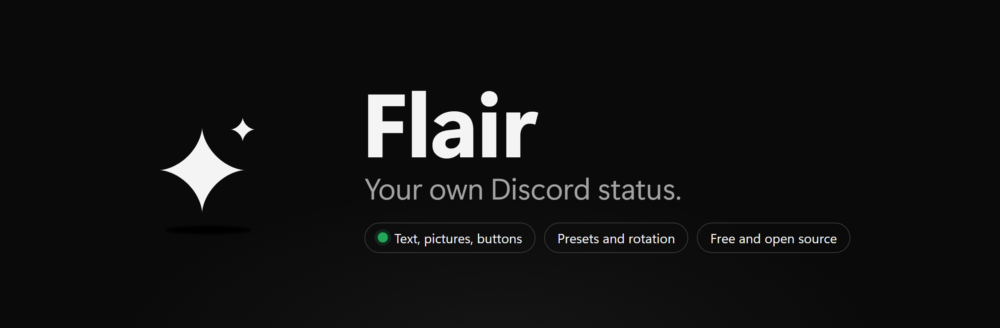

<p align="center">
  
</p>

<p align="center">
  <a href="https://github.com/slashneck/Flair/releases/latest"></a>
  <a href="https://github.com/slashneck/Flair/releases"></a>
  
  <a href="LICENSE"></a>
</p>

<p align="center">
  <a href="https://github.com/slashneck/Flair/releases/latest"><b>Download for Windows</b></a>
  &nbsp;&nbsp;|&nbsp;&nbsp;
  <a href="#getting-started">Getting started</a>
  &nbsp;&nbsp;|&nbsp;&nbsp;
  <a href="#features">Features</a>
  &nbsp;&nbsp;|&nbsp;&nbsp;
  <a href="#building">Build it yourself</a>
</p>

<br>

Flair puts your own status on your Discord profile: the "Playing", "Listening to", "Watching" or "Competing in" card,
with your text, pictures, up to two buttons, a timer and a party size. Design it with a live preview of the card, save
as many as you like, switch with a hotkey or let them rotate, and send them to friends as a tiny file. It uses Discord's
official Rich Presence connection, the same one games use, so it never touches your account.

## Getting started

1. **Install Flair.** Download `FlairSetup-x.y.z.exe` from the
   [latest release](https://github.com/slashneck/Flair/releases/latest) and run it.
2. **Pick a preset and press Go live.** Keep the Discord desktop app open and your status shows up as "Playing Flair".
3. **Optional: your own name.** Discord shows the name of a Discord application after "Playing". For a different one,
   make an app in the [Discord Developer Portal](https://discord.com/developers/applications) and paste its
   Application ID into Flair. The Guide inside the app walks you through it.

Don't see it? In Discord, open User Settings, Activity Privacy and turn on sharing your detected activities.

## Features

**A live preview.** The editor shows your profile card the way Discord draws it, with your own name and picture, and
updates as you type: the activity type, the two text lines, a large and a small picture with hover text, buttons with
links, an elapsed timer or a countdown, and "2 of 5" party sizes. A member list row underneath shows what people see
next to your name.

**Presets.** Every status is a preset. Duplicate, rename and drag them around, show one with a double-click, and give
each its own hotkey.

**Rotation.** Pick a few presets and Flair cycles through them every 15 seconds or more, in order or shuffled like a
playlist. The elapsed timer keeps counting through the switches.

**Pictures from anywhere.** Paste any https link, GIFs included, or upload art to your Discord app and use it by name.
Flair shows your app's uploaded pictures so you can click one in.

**Always there.** Flair waits in the tray, starts with Windows and brings back your last status. When Discord is closed
it says so and reconnects by itself once Discord is back.

**Share with friends.** Export one preset or a few to a small `.flair` file. Your friend double-clicks it or drops it
on Flair, and it's in.

**Shared presets.** Browse presets other people shared on
[Patchbay](https://patchbayapps.com/app/flair/presets), each shown as a card on your own profile, and import
one with a click. Share yours there too. Shared presets go through the same checks as a file you open yourself, and
Flair shows where their buttons lead before you import.

## Hotkeys

| Action | Default |
| --- | --- |
| Turn the status on or off | <kbd>Ctrl</kbd> + <kbd>Alt</kbd> + <kbd>F</kbd> |
| Next preset | <kbd>Ctrl</kbd> + <kbd>Alt</kbd> + <kbd>N</kbd> |
| Show a specific preset | not set, one per preset |

Everything can be changed in Settings. In the window, <kbd>Ctrl</kbd> + <kbd>N</kbd> makes a new preset,
<kbd>Ctrl</kbd> + <kbd>D</kbd> duplicates one and <kbd>Ctrl</kbd> + <kbd>O</kbd> imports a file.

## Good to know

- The bold name after "Playing" is a Discord app's name and can't be typed in per status. It's "Flair" unless you
  bring your own app. For several names, make one app per name and give a preset its own Application ID.
- Discord hides your own buttons from you. Your friends see them.
- Discord accepts a few status changes per 20 seconds. Flair waits and sends the newest one, so nothing gets lost.
- Flair can't change the custom status bubble (the text with an emoji). Only Discord itself may do that, and tools that
  try get accounts banned.

## Install

Download `FlairSetup` from the [latest release](https://github.com/slashneck/Flair/releases/latest) and run it. It
installs for your Windows account only, so no admin rights are needed, and it keeps itself up to date.

The setup isn't code signed yet, so Windows SmartScreen may say it "protected your PC". Click **More info** and then
**Run anyway**. Every release lists the SHA-256 checksum of its files.

You need Windows 10 (version 1903 or newer) or Windows 11, 64 bit, and the Discord desktop app. The window uses the
Microsoft WebView2 Runtime, which comes with Windows 11 and most Windows 10 PCs.

## Where your files are

| What | Where |
| --- | --- |
| Presets and settings | `%AppData%\Flair` |
| The program | `%LocalAppData%\Programs\Flair` |

Updates only replace program files. Uninstalling removes the program and leaves your presets where they are.

## Privacy

Flair has no account, no telemetry and no server. It talks to the Discord app on your PC through its local Rich
Presence connection and never sees your login or token. It only goes online for these things:

- **Your pictures.** The preview loads the https pictures your presets point at, just like Discord does.
- **Your app's name and art.** Flair asks Discord for the public name and uploaded pictures of the Discord app your
  status uses, so the preview can show them.
- **Shared presets.** Only while you have the *Presets* tab open, Flair asks Patchbay for the list and downloads the one
  you import. Nothing about you is sent.
- **The update check** asks GitHub whether a new version exists. Switch it off under Settings.

## Building

You need the .NET 8 SDK.

```powershell
.\build-release.ps1
```

The script publishes Flair and writes the setup, the update zip with its checksum and a source zip to `dist`. For
development, use `dotnet run --project src\Flair`. The window's page lives in `src\Flair\wwwroot` and also opens in a
normal browser with sample data, which is handy for working on the look.

## License

Copyright (C) 2026 slashneck. Flair is free software under the [GNU General Public License version 3](LICENSE): you can
use, change and share it, and any version you share has to stay under the same license with its source code available.
The license doesn't cover the Flair name or logo (GPLv3 section 7e), so please give modified versions their own name.

Flair includes the WebView2 SDK and the .NET runtime. Discord is a trademark of Discord Inc.; Flair isn't made by or
affiliated with Discord. See [THIRD-PARTY-NOTICES.md](THIRD-PARTY-NOTICES.md).
